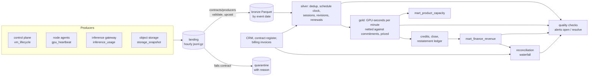

# ai-cloud-metering-platform

Usage metering for a GPU cloud, from raw producer events to the revenue finance closes the month
on: data contracts, event-time ingestion, per-minute rating against reserved capacity, an
append-only ledger with restatements, reconciliation with the billing system, data-quality checks
with alerting, column lineage, GDPR erasure, Dagster orchestration, and the rating step on Spark.

It runs on a simulated cloud (36 customers, 236 VMs, 378k events over six weeks) whose delivery
has the faults real telemetry has: retries, spool replays, late data, a regional collector outage,
lost stop events, skewed host clocks, a declared schema change and a unit bug. Because the world
is simulated, every figure below is checked against the truth, which the pipeline never reads.

## Results

From `acm replay` (all faults on, a pipeline run every 12 hours from 1 September to 18 October):

| | September (closed 3 Oct) | October (open) |
|---|---|---|
| Truth | $449,769.31 | $272,615.55 |
| This platform | $449,769.30 | $272,615.55 |
| Largest error for any customer and month | $0.01 | $0.00 |
| Naive pipeline on the same data | $480,108.62 (+$30,339) | $317,808.15 (+$45,193) |

- The only error above zero comes from lost stop events, which no pipeline can recover exactly;
  the billing rule caps it at one heartbeat of GPU time (docs/BILLING_RULES.md).
- **September closed at $449,724.84** on 3 October at 12:00. The eu-north1 outage data arrived the
  next morning and restated it by **$44.46**, as adjustment entries with the reason, without
  changing the closed figure.
- **The billing system's invoices were $5,756.37 higher** in charges. Reconciliation explains all
  of it, per customer, to $0.00 unexplained: $4,230.14 renewals charged on top of the commitments
  they replace, $1,210.57 sessions without a stop event billed to month end, $369.45 hourly
  rounding in one region, $5.50 inference retries, minus $59.29 of usage it could not have seen at
  its cutoff. **$1,300.75 of it was paid from customers' prepaid credits**, so their invoice totals
  agreed and only their balances showed it.
- Every fault was detected while it happened: the outage within 12 hours, the unit bug the morning
  it started; both alerts cleared when the data was corrected. See reports/EVALUATION.md.
- Rating on **Spark equals DuckDB to the cent** on all 72 customer-months (reports/spark_rating.json).

Each fault alone, on a fresh world (reports/DRILLS.md):

| fault, alone | alert | billed correctly |
|---|---|---|
| none (clean world) | nothing pages | to the cent |
| 1% producer retries and agent spool replays | none, by design (below the 3% threshold) | to the cent |
| a gateway delivering every file twice | `duplicates` | to the cent |
| 0.5% of events 1 to 48 h late | none needed (recomputed) | to the cent |
| regional collector outage, data delivered after the close | `freshness`, then `restatement` | to the cent, via adjustments |
| 2% of stop events lost | `inferred_session_end` | within $0.20 (rule allows up to $3.67) |
| host clocks off by up to 5 minutes | `clock_skew` | to the cent |
| a declared schema change (v2 renames) | none needed (upcast) | to the cent |
| tokens reported in thousands for 36 h | `token_plausibility`, cleared by the corrected revision | to the cent |
| an undeclared field rename | `quarantine` and `freshness` | held back ($38.91), not guessed |

The naive pipeline is off by $800 to $1,350 for September in every drill, including the clean one. The outage also opens `heartbeat_coverage` and `inferred_session_end`: while the collector is down, sessions look as if they ended, and are corrected when the data arrives.

## How it works



- **Contracts** (`contracts/producers/*.yaml`): fields, types, enums, the dedup key, the event-time
  field, PII fields and schema versions with renames. A record that breaks its contract is
  quarantined with the reason. `acm contracts --check --against origin/main` fails CI on breaking
  changes to producer or mart contracts.
- **Time**: usage belongs to the month it happened in, and heartbeat time comes from the schedule
  (`started_at + seq × 300 s`), not from host clocks (ADR 1). Lineage proves a host clock cannot
  reach a money column.
- **Rating**: sessions are expanded to minutes and netted against the GPUs a customer has committed
  in that minute, type and region; the rest is on-demand at the effective-dated list price.
  Renewals replace the commitment they renew. Inference takes the highest revision. Credits pay
  on-demand, oldest month first. See docs/BILLING_RULES.md.
- **Period close** (ADR 3): a month closes at the time in `config/periods.yaml`; later changes
  are adjustment entries with a reason. `revenue_as_of(month, t)` answers what was reported when.
- **Reconciliation** (ADR 4): each suspected billing behaviour is applied to the platform's own
  data and the models re-run, so a wrong hypothesis explains nothing and the residual stays visible.
- **Quality** (`config/checks.yaml`, docs/RUNBOOK.md): freshness per region, duplicates,
  quarantine share, token plausibility, heartbeat coverage, clock skew, lost stop events, unpriced
  usage, unknown customers, mart contracts, restatements and reconciliation. An error opens one
  alert that stays open until the check passes.
- **Lineage** (`acm lineage`): column lineage parsed from the model SQL with sqlglot, emitted as
  OpenLineage events with the column-lineage facet (reports/lineage.json, docs/LINEAGE.md).
- **Erasure** (ADR 6): `acm erase` pseudonymises a person's email in landing, bronze, quarantine
  and the warehouse, verifies nothing is left and revenue did not move, and keeps a salted-hash
  audit; later arrivals of the same person are pseudonymised on ingestion.
- **Orchestration** (`src/acm/dagster_defs.py`): assets for each stage, every check as an asset
  check on the asset it guards, a landing-file sensor, a three-hourly schedule and one at the close.
- **Scale** (ADR 5): DuckDB runs a pipeline run in about two seconds here. The step that grows
  with fleet size times time, rating, also runs on Spark (`src/acm/spark_rating.py`) and is checked
  against DuckDB to the cent.

## Run it

```bash
pip install -e ".[dev]"            # add ,spark for the Spark rating (needs Java 17+)
pytest -q -m "not slow"            # about a minute
pytest -q -m slow                  # replay, drills, Dagster, Spark on small worlds

acm replay                         # the whole period, 36 customers: writes reports/
acm drill                          # each fault alone: writes reports/DRILLS.md
acm spark-rate --root data/replay  # Spark rating vs DuckDB

acm simulate --root data/lake      # a landing zone to run against
acm run --root data/lake --now 2026-10-04T12:00:00Z
acm lineage --root data/lake --impact bronze_gpu_heartbeat.host_time_ts
acm erase --root data/lake --email someone@company.example --request-id DSR-1

docker compose run --rm simulate && docker compose up dagster daemon   # Dagster UI on :3000
```

## Layout

```
contracts/          producer and mart contracts (YAML)
config/             prices, checks, period close
src/acm/
  ingest.py         landing -> bronze, quarantine, compaction, suppression of erased subjects
  models/*.sql      silver and gold
  transform.py      runs the models; pipeline.py: one run as steps
  periods.py        credits, close, restatement, finance mart
  recon.py          reconciliation waterfall
  quality.py        checks and alerts
  lineage.py        sqlglot column lineage, OpenLineage events
  privacy.py        erasure with verification
  dagster_defs.py   assets, asset checks, sensor, schedules
  spark_rating.py   rating on Spark
  naive.py          the baseline most teams write first
  sim/              the simulated cloud, its delivery faults and the billing system (harness only)
docs/               billing rules, ADRs, runbook, lineage
reports/            generated by acm replay / drill / spark-rate
```

## Limits

- The data is simulated. The faults are the ones I know telemetry pipelines have; a real fleet
  will have others, and the reconciliation steps model five billing behaviours, not every one.
- The lake is a local directory and the warehouse one DuckDB file with a single writer. An object
  store, a table format with concurrent writers (Iceberg, Delta) and streaming ingestion are not
  here; ADR 5 says where they would go.
- On Spark only rating runs; silver is exported from DuckDB.
- Records quarantined by an undeclared schema change stay out of revenue until the contract is
  fixed and the files re-delivered; there is no automatic replay from quarantine.
- Erasure does not reach backups, files already exported, or other systems' copies.
