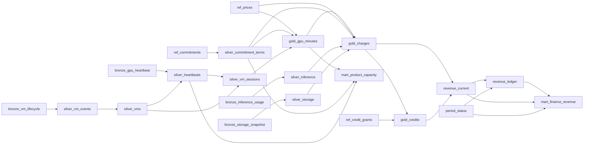

# Lineage

Generated by `acm lineage` from the model SQL (sqlglot). Do not edit by hand.

## mart_finance_revenue.total comes from

- `bronze_gpu_heartbeat.seq`
- `bronze_inference_usage.input_tokens`
- `bronze_inference_usage.output_tokens`
- `bronze_storage_snapshot.bytes_stored`
- `bronze_vm_lifecycle.event_time_ts`
- `bronze_vm_lifecycle.event_type`
- `bronze_vm_lifecycle.gpu_count`
- `ref_commitments.ends`
- `ref_commitments.gpus`
- `ref_commitments.starts`
- `ref_commitments.usd_per_gpu_hour`
- `ref_credit_grants.usd`
- `ref_prices.usd`

## mart_finance_revenue.gpu_on_demand comes from

- `bronze_gpu_heartbeat.seq`
- `bronze_inference_usage.input_tokens`
- `bronze_inference_usage.output_tokens`
- `bronze_storage_snapshot.bytes_stored`
- `bronze_vm_lifecycle.event_time_ts`
- `bronze_vm_lifecycle.event_type`
- `bronze_vm_lifecycle.gpu_count`
- `ref_commitments.ends`
- `ref_commitments.gpus`
- `ref_commitments.starts`
- `ref_commitments.usd_per_gpu_hour`
- `ref_credit_grants.usd`
- `ref_prices.usd`

## mart_finance_revenue.inference comes from

- `bronze_gpu_heartbeat.seq`
- `bronze_inference_usage.input_tokens`
- `bronze_inference_usage.output_tokens`
- `bronze_storage_snapshot.bytes_stored`
- `bronze_vm_lifecycle.event_time_ts`
- `bronze_vm_lifecycle.event_type`
- `bronze_vm_lifecycle.gpu_count`
- `ref_commitments.ends`
- `ref_commitments.gpus`
- `ref_commitments.starts`
- `ref_commitments.usd_per_gpu_hour`
- `ref_credit_grants.usd`
- `ref_prices.usd`

## Columns sqlglot could not fully resolve

- none
